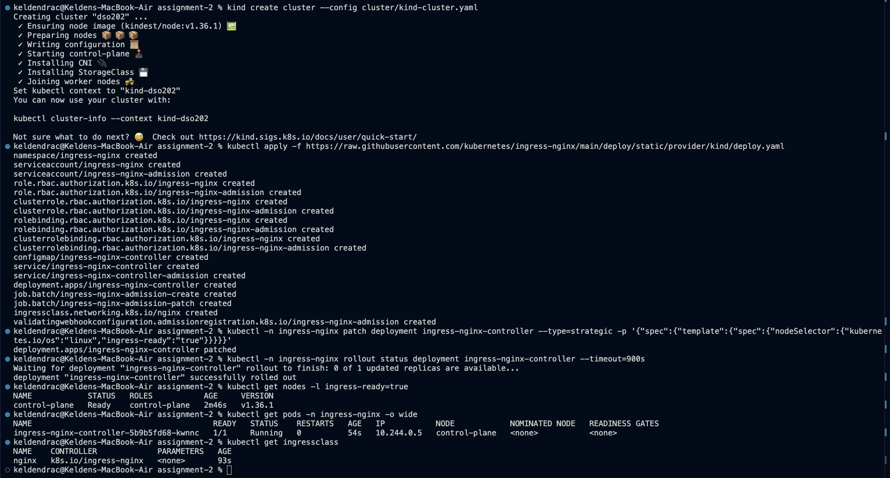
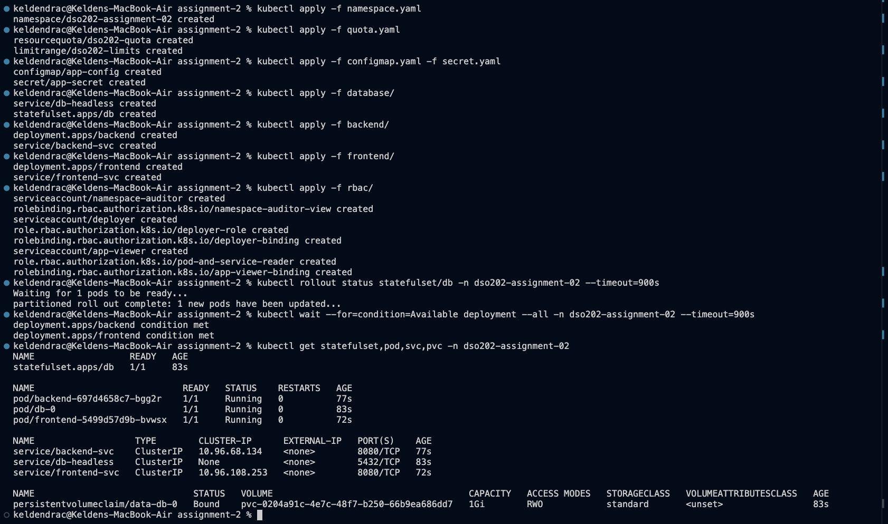
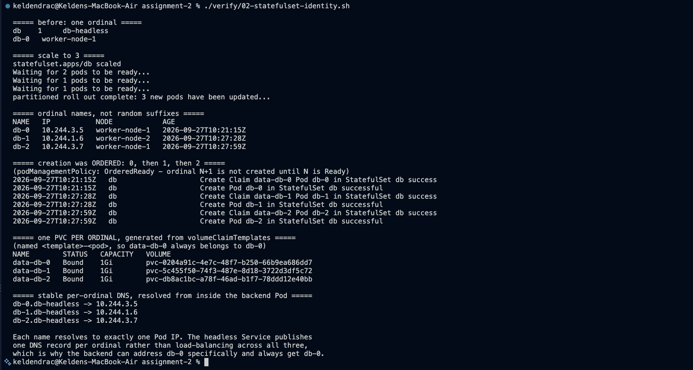
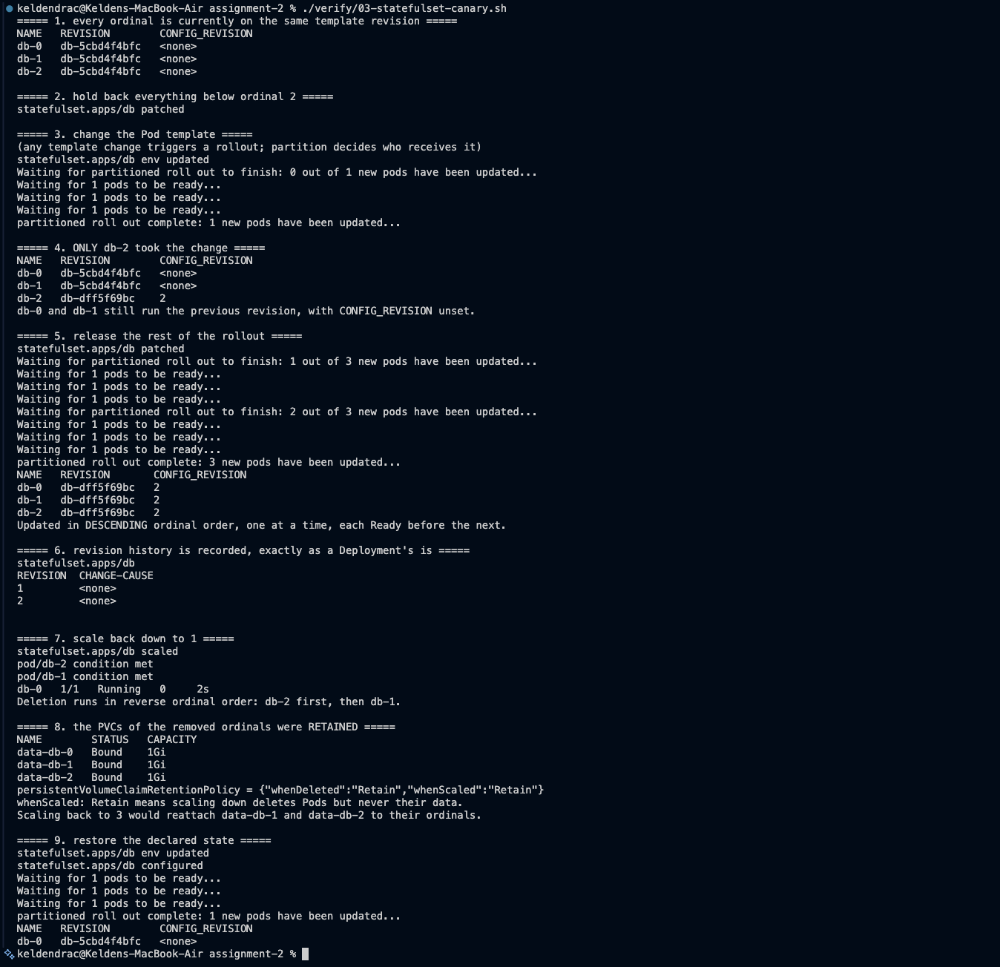
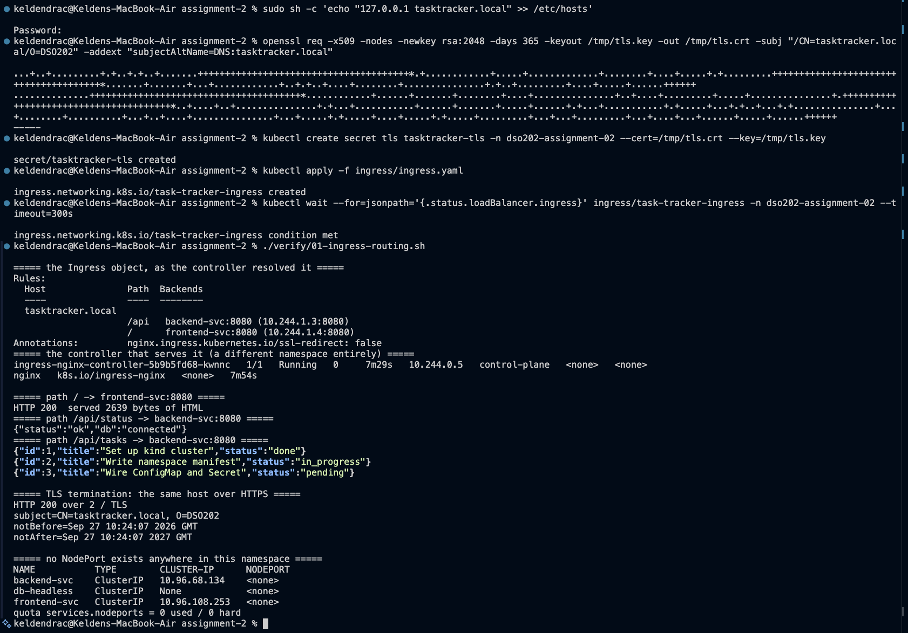
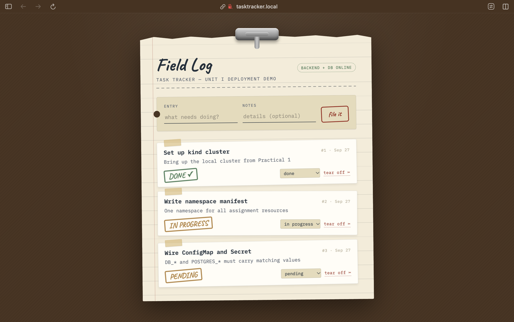
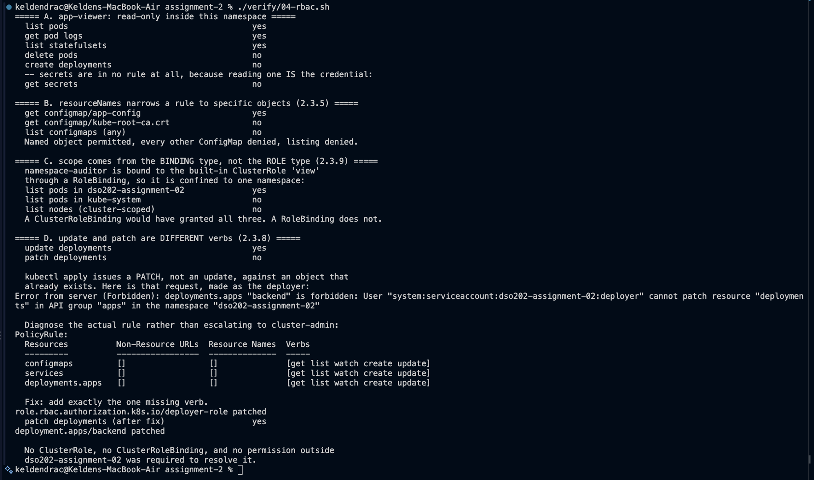
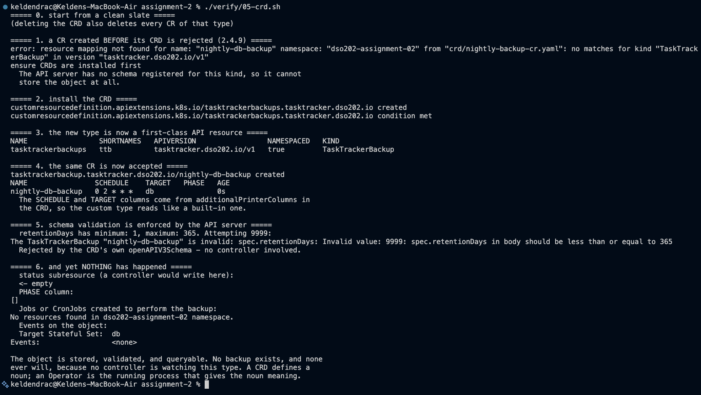
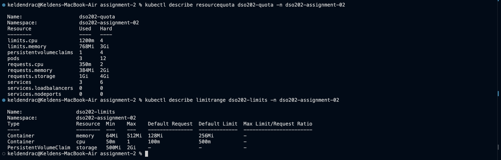

# DSO202 - Assignment 2: Applying Unit II to the Three-Tier Deployment

The Assignment 1 Task Tracker, re-implemented with Unit II concepts. Same three
container images, same application, same cluster topology. Everything that
changed is Kubernetes configuration, and every change is traceable to a specific
section of the Unit II notes.

| Unit II topic | What it replaced | Where |
|---|---|---|
| 2.1 StatefulSets | database Deployment + hand-written PVC | [`database/`](database/) |
| 2.2 Ingress | frontend NodePort Service | [`ingress/`](ingress/) |
| 2.3 RBAC | the single read-only Role of Assignment 1 | [`rbac/`](rbac/) |
| 2.4 CRDs | nothing - new capability | [`crd/`](crd/) |

**Scope note.** The module descriptor lists 2.5 Service Mesh with Istio as part
of Unit II, but the issued notes end at 2.4.11 and contain no Section 2.5. No
service mesh, sidecar injection, or Istio resource is used anywhere in this
assignment.

| | |
|---|---|
| **Namespace** | `dso202-assignment-02` |
| **Cluster** | kind cluster `dso202`, 1 control-plane + 2 workers, Kubernetes v1.36.1 |
| **Entry point** | `http://tasktracker.local` via the NGINX Ingress Controller |
| **Images** | `sarojsanyasi/dso202-{frontend,backend,db}:1.0`, unchanged and pinned |

---

## 1. Repository layout

```
assignment-2/
├── namespace.yaml                        the tenancy boundary
├── configmap.yaml                        non-sensitive config for all tiers
├── secret.yaml                           credentials, both naming conventions
├── quota.yaml                            ResourceQuota + LimitRange
├── cluster/
│   └── kind-cluster.yaml                 ingress-ready label + ports 80/443
├── database/
│   ├── statefulset.yaml                  2.1 - ordinals, volumeClaimTemplates
│   └── headless-service.yaml             2.1 - stable per-ordinal DNS
├── backend/
│   ├── deployment.yaml                   still a Deployment, deliberately
│   └── service.yaml                      ClusterIP
├── frontend/
│   ├── deployment.yaml
│   └── service.yaml                      ClusterIP - no longer NodePort
├── ingress/
│   └── ingress.yaml                      2.2 - one host, two paths, TLS
├── rbac/
│   ├── viewer.yaml                       2.3 - Role, RoleBinding, resourceNames
│   ├── clusterrole-binding.yaml          2.3 - ClusterRole scoped by RoleBinding
│   └── deployer.yaml                     2.3 - the update-vs-patch scenario
├── crd/
│   ├── tasktrackerbackup-crd.yaml        2.4 - a new API type
│   └── nightly-backup-cr.yaml            2.4 - one instance of it
├── verify/                               the scripts that produced the evidence
│   ├── 01-ingress-routing.sh
│   ├── 02-statefulset-identity.sh
│   ├── 03-statefulset-canary.sh
│   ├── 04-rbac.sh
│   └── 05-crd.sh
├── evidence/                             screenshots 01-09
└── README.md
```

## 2. Deploying from scratch

### 2.1 Cluster

The Assignment 1 cluster config will not work here. Two additions are required
by 2.2, both in [`cluster/kind-cluster.yaml`](cluster/kind-cluster.yaml):

- `node-labels: ingress-ready=true` on the control-plane;
- `extraPortMappings` for host ports **80 and 443** instead of 30080, because
  the Ingress controller, not a NodePort, is now the way in.

```bash
kind create cluster --config cluster/kind-cluster.yaml
```

### 2.2 Ingress controller

An Ingress object does nothing on its own. 2.2.3 is explicit that it is a
passive configuration record and that a separate controller must be running to
read and act on it.

```bash
kubectl apply -f https://raw.githubusercontent.com/kubernetes/ingress-nginx/main/deploy/static/provider/kind/deploy.yaml
kubectl -n ingress-nginx patch deployment ingress-nginx-controller --type=strategic -p '{"spec":{"template":{"spec":{"nodeSelector":{"kubernetes.io/os":"linux","ingress-ready":"true"}}}}}'
kubectl -n ingress-nginx rollout status deployment ingress-nginx-controller --timeout=900s
```

**The patch is not optional, and it is not in the notes.** 2.2.7 gives the
`kubectl apply` line alone, on the assumption that the kind-provider manifest
pins the controller to nodes labelled `ingress-ready=true`. The current upstream
manifest no longer does: its only nodeSelector is `kubernetes.io/os: linux`.
Applied unpatched on this three-node cluster, the controller scheduled onto
`worker-node-2`, which has no port mappings, and `http://localhost` reached
nothing at all - a failure that presents as "the Ingress does not work" while
the Ingress object itself is perfectly correct.

This is the concrete form of the warning in 2.2.6: ingress-nginx entered
maintenance mode in March 2026, and the health and behaviour of whichever
ingress technology a team depends on has to be re-checked rather than assumed
from a tutorial. The patch restores the nodeSelector the notes assume.



The control-plane carries `ingress-ready=true`, the controller Pod is `Running`
**on control-plane** at `10.244.0.5`, and the `nginx` IngressClass is registered
with controller `k8s.io/ingress-nginx`. Only with all three true does any
Ingress object in the cluster become live routing behaviour.

### 2.3 Application

```bash
kubectl apply -f namespace.yaml
kubectl apply -f quota.yaml
kubectl apply -f configmap.yaml -f secret.yaml
kubectl apply -f database/
kubectl apply -f backend/
kubectl apply -f frontend/
kubectl apply -f rbac/
kubectl rollout status statefulset/db -n dso202-assignment-02 --timeout=900s
kubectl wait --for=condition=Available deployment --all -n dso202-assignment-02 --timeout=900s
```

### 2.4 Ingress and TLS

The TLS certificate is generated and loaded imperatively rather than committed,
so no private key enters version control. 2.2.6 notes that production uses
cert-manager to issue and rotate these automatically instead.

```bash
sudo sh -c 'echo "127.0.0.1 tasktracker.local" >> /etc/hosts'
openssl req -x509 -nodes -newkey rsa:2048 -days 365 -keyout /tmp/tls.key -out /tmp/tls.crt -subj "/CN=tasktracker.local/O=DSO202" -addext "subjectAltName=DNS:tasktracker.local"
kubectl create secret tls tasktracker-tls -n dso202-assignment-02 --cert=/tmp/tls.crt --key=/tmp/tls.key
kubectl apply -f ingress/ingress.yaml
```

The `/etc/hosts` line is ordinary local Ingress practice, not a workaround: an
Ingress routes on the HTTP `Host` header, so the host has to resolve the name
somehow. The notes' own example assumes public DNS for
`tasktracker.example.com`; a `.local` test host needs a hosts entry instead.



`statefulset.apps/db` at `1/1`, with its Pod named **`db-0`** rather than a
random suffix, and a PVC named **`data-db-0`** Bound to 1Gi on StorageClass
`standard`. All three Services are `ClusterIP`; `db-headless` shows
`CLUSTER-IP: None`. There is no NodePort anywhere.

---

## 3. StatefulSets (2.1)

### 3.1 Why the database moved, and why nothing else did

Assignment 1 ran PostgreSQL as a single-replica Deployment mounting one
hand-written PVC. That works, but the replica has no identity: its Pod name is
disposable, so the backend had to address it through a Service because the Pod
behind that Service could be called anything at any time.

A StatefulSet changes the contract. `db-0` is always `db-0`, resolves at the
same DNS name after any rescheduling, and is reattached to the same PVC. The
backend's `DB_HOST` therefore changed from a Service name to a **per-ordinal Pod
name**:

```yaml
DB_HOST: "db-0.db-headless"    # was: db-svc
```

The backend and frontend stayed Deployments. 2.1.6 is explicit that a
StatefulSet should be reached for only when replica identity or per-replica
storage is genuinely required, and that interchangeable replicas belong in a
Deployment. Neither tier has state, an identity, or a volume, so converting them
would buy ordered, slower rollouts for nothing.

### 3.2 Ordinal identity, ordered creation, per-ordinal storage

The application runs one database replica. The provided image is stock
PostgreSQL with no replication configuration, so three replicas would be three
unrelated empty databases rather than a cluster - exactly the misconception
2.1.9 warns about, that a StatefulSet supplies identity but does not make an
application use it. Scaling to three therefore demonstrates **Kubernetes
behaviour**, not database clustering, and the StatefulSet is returned to one
replica afterwards.

```bash
./verify/02-statefulset-identity.sh
```



Four separate guarantees are visible:

**Ordinal naming.** `db-0`, `db-1`, `db-2`. Compare the backend Pod in
screenshot 02, `backend-697d4658c7-bgg2r` - a Deployment's replicas get a
ReplicaSet hash and a random suffix precisely because they are interchangeable.

**Ordered creation.** The `SuccessfulCreate` events are timestamped
`10:21:15Z`, `10:27:28Z`, `10:27:59Z`. `db-2` was not created until 31 seconds
after `db-1`, because `podManagementPolicy: OrderedReady` requires ordinal N to
be Running and Ready before N+1 is created at all.

**One PVC per ordinal.** `data-db-0`, `data-db-1`, `data-db-2`, each 1Gi and
separately Bound to its own PersistentVolume. These were generated from
`volumeClaimTemplates`. A PVC declared in the Pod spec instead would have been
one volume shared by all three replicas, which for PostgreSQL means data
corruption.

**Stable per-ordinal DNS.** `db-0.db-headless` resolves to `10.244.3.5`,
`db-1.db-headless` to `10.244.1.6`, `db-2.db-headless` to `10.244.3.7` - each to
exactly one Pod IP, matching the table above it. Note also that the ordinals are
spread across `worker-node-1` and `worker-node-2`: the DNS name is bound to the
ordinal, not to a node or an address. An ordinary ClusterIP Service would have
load-balanced across all three, which is why 2.1.9 lists reusing one as a
distinct failure mode.

### 3.3 Canary rollout with `partition`, and PVC retention

```bash
./verify/03-statefulset-canary.sh
```



Reading the transcript in order:

1. All three ordinals start on controller revision `db-5cbd4f4bfc`.
2. `partition` is raised to `2`, so only ordinals >= 2 may update.
3. The Pod template changes.
4. **Only `db-2` moves** to revision `db-dff5f69bc` and receives
   `CONFIG_REVISION=2`. `db-0` and `db-1` are untouched, still on the old
   revision with the variable unset. This is the canary: one replica carries the
   change while the rest keep serving the previous configuration.
5. `partition` drops to `0` and the rollout completes in **descending** ordinal
   order, one Pod at a time, each Ready before the next.
6. `kubectl rollout history` shows revisions 1 and 2 recorded as
   ControllerRevisions, so the change is revertible exactly as a Deployment's is.
7. Scaling back to 1 deletes in **reverse** order: `db-2` first, then `db-1`.
8. **All three PVCs remain Bound.** `persistentVolumeClaimRetentionPolicy` is
   `{"whenDeleted":"Retain","whenScaled":"Retain"}`, so scaling down destroyed
   Pods and kept every byte of their data. Scaling back to 3 would reattach
   `data-db-1` and `data-db-2` to their original ordinals. 2.1.6 recommends
   setting this explicitly rather than relying on the cluster default, because
   accidental retention or deletion of a database's storage is the most damaging
   thing a misconfigured StatefulSet can do.

Step 9 is worth its own note. Restoring the declared state required
`kubectl set env ... CONFIG_REVISION-` **before** `kubectl apply`, because
`apply` alone does not undo `kubectl set env`. The variable was never present in
the `last-applied-configuration` annotation, so the three-way merge treats it as
a field owned by another actor and preserves it. That is the same
declarative/imperative divergence Assignment 1 examined, appearing here as a
concrete operational trap rather than a comparison exercise.

---

## 4. Ingress (2.2)

### 4.1 What replaced the NodePort

Assignment 1 exposed the frontend on NodePort 30080. 2.2.2 sets out why that
does not scale: one port per Service, port numbers pushed into URLs, and a fixed
node port range that runs out. `frontend-svc` is now a plain ClusterIP, and a
single Ingress object routes by path to both tiers.

The Ingress deliberately **omits** `nginx.ingress.kubernetes.io/rewrite-target`,
which the 2.2.7 worked example includes. Copying it here would break the
application: rewrite-target rewrites the matched path before forwarding, so
`/api/tasks` would arrive at the backend as `/` and return 404. This backend
serves the `/api` prefix natively. 2.2.6 makes exactly this point - annotations
are controller- and application-specific and must be checked at the time of use,
not inherited from a tutorial.

The one annotation that is present, `ssl-redirect: "false"`, exists so the same
host can be demonstrated over both plain HTTP and TLS. ingress-nginx redirects
HTTP to HTTPS by default once `spec.tls` is set; production would leave that on.

```bash
./verify/01-ingress-routing.sh
```



**Rules resolved to live endpoints.** `kubectl describe ingress` shows
`/api -> backend-svc:8080 (10.244.1.3:8080)` and
`/ -> frontend-svc:8080 (10.244.1.4:8080)`. The Backends column carrying a
resolved endpoint IP is the check 2.2.8 uses first in its 502 diagnosis: it
proves the Ingress object, its Service reference, and the Service's endpoints
are all correctly linked.

**Layer 7 routing.** Every request in the screenshot goes to the same host and
the same port. Only the path differs, and the path alone decides which Service
answers: `/` returns 2639 bytes of HTML from the frontend, `/api/status` returns
`{"status":"ok","db":"connected"}` from the backend, `/api/tasks` returns the
seeded rows. This is the routing decision made on structured HTTP data that a
Layer 4 NodePort cannot make.

**TLS termination.** The same host over HTTPS returns `HTTP 200 over 2`, and the
certificate presented is `CN=tasktracker.local, O=DSO202`, valid Sep 2026 to Sep
2027. The controller decrypts once, at the edge, and forwards plain HTTP
internally.

**No NodePort exists.** All three Services show `NODEPORT <none>`, and the quota
reports `services.nodeports = 0 used / 0 hard` - the namespace cannot create one.

### 4.2 The Unit I limitation this removed

Assignment 1's frontend could not reach its backend from a browser. `BACKEND_URL`
had to be a cluster-internal Service address, the page's JavaScript runs in the
browser rather than in the Pod, and a browser is not a cluster DNS client, so
the UI showed `BACKEND UNREACHABLE` and CRUD had to be evidenced through a
port-forwarded backend instead.

Ingress dissolves that problem rather than working around it. Because `/` and
`/api` are served from one host, `BACKEND_URL` is now `http://tasktracker.local`
and the browser's API call is **same-origin**, routed to `backend-svc` by the
controller at Layer 7.



`tasktracker.local` in the address bar with no port number, the
**BACKEND + DB ONLINE** badge, and the seeded rows rendering with working status
and delete controls. No port-forward, no NodePort, and no host alias for a
cluster-internal name.

> The page subtitle reads "TASK TRACKER - UNIT I DEPLOYMENT DEMO". That string is
> baked into the tutor-provided frontend image and is not set by any manifest in
> this assignment; the deployment shown is `dso202-assignment-02`.

---

## 5. RBAC (2.3)

Assignment 1 carried a single read-only Role as an optional bonus. Unit II
covers the full model, so this namespace defines three distinct identities, each
built to demonstrate a different property of the authorization system.

```bash
./verify/04-rbac.sh
```



Every claim below is verified with `kubectl auth can-i` rather than by reading
the manifests, which 2.3.6 recommends as standard practice.

### A. `app-viewer` - least privilege in one namespace

`list pods`, `get pods/log`, `list statefulsets` all return **yes**;
`delete pods` and `create deployments` return **no**. `get secrets` returns
**no**, because `secrets` appears in no rule at all. That omission is
deliberate: a Secret's value is only base64-encoded, so read access to one is
equivalent to holding the credential itself.

Per 2.3.6, this is a dedicated ServiceAccount. Granting the namespace's
`default` ServiceAccount these permissions would silently extend them to every
Pod that does not name another one.

### B. `resourceNames` - narrowing below the resource type

`get configmaps/app-config` returns **yes**, `get configmaps/kube-root-ca.crt`
returns **no**, and `list configmaps` returns **no**. The rule is scoped to one
named object, which is a finer grain than resource-type-level rules can express
and the right shape when a workload only ever touches a known, fixed set of
objects.

### C. Scope comes from the binding, not the role

`namespace-auditor` is bound to Kubernetes's own built-in **ClusterRole** `view`
through a **RoleBinding**. The result: `list pods` in `dso202-assignment-02`
returns **yes**, `list pods` in `kube-system` returns **no**, and `list nodes`
returns **no**.

This disproves the 2.3.9 pitfall directly. A ClusterRoleBinding would have
granted all three; a RoleBinding confines the same ClusterRole to its own
namespace. 2.3.6 recommends exactly this pattern - reuse a well-tested
ClusterRole inside a namespace rather than writing a fresh Role per namespace.
`view` is also an aggregated ClusterRole, assembled by the API server from every
ClusterRole labelled to match its `aggregationRule`.

### D. `update` and `patch` are different verbs

`deployer-role` grants `create` and `update` on Deployments but not `patch`.
`kubectl auth can-i update deployments` returns **yes**;
`kubectl auth can-i patch deployments` returns **no**.

`kubectl apply` issues a **patch** against an object that already exists, so the
identity fails on every deployment after the first:

```
Error from server (Forbidden): deployments.apps "backend" is forbidden:
User "system:serviceaccount:dso202-assignment-02:deployer" cannot patch
resource "deployments" in API group "apps" in the namespace
"dso202-assignment-02"
```

The diagnosis is the point. `kubectl describe role` shows the rule granting
`[get list watch create update]`, the missing verb is identified precisely, and
one verb is added. The subsequent request succeeds. At no stage was
`cluster-admin`, a ClusterRoleBinding, or any permission outside the namespace
required - which is the alternative 2.3.9 names as the single most common cause
of over-privileged workloads in real clusters.

---

## 6. Custom Resource Definitions (2.4)

```bash
./verify/05-crd.sh
```



[`crd/tasktrackerbackup-crd.yaml`](crd/tasktrackerbackup-crd.yaml) defines a
`TaskTrackerBackup` type in the group `tasktracker.dso202.io`, with a schema, a
`status` subresource, and printer columns.
[`crd/nightly-backup-cr.yaml`](crd/nightly-backup-cr.yaml) is one instance.

**A CR before its CRD is rejected outright.** Applied first, the API server
answers `no matches for kind "TaskTrackerBackup"` - it has no schema registered
for the type, so it cannot store the object at all (2.4.9).

**After installation the type is first-class.** `kubectl api-resources` lists
`tasktrackerbackups` with short name `ttb`, namespaced, kind
`TaskTrackerBackup`. The CR is accepted and `kubectl get` renders the SCHEDULE
and TARGET columns declared in `additionalPrinterColumns`, so the custom type
reads exactly like a built-in one.

**The API server enforces the schema.** Patching `retentionDays` to 9999 is
rejected: `spec.retentionDays in body should be less than or equal to 365`.
No controller is involved in that validation; it comes from the CRD's own
`openAPIV3Schema`.

**And nothing has happened.** The `status` subresource is empty. The PHASE
column is empty. No Job or CronJob exists in the namespace. The object has no
Events.

That absence is the evidence, and it is the single most common misconception
about the Operator pattern (2.4.9). A CRD teaches the API server a new **noun**.
An Operator - a custom controller running the watch, informer, and workqueue
architecture of 2.4.4, reconciling desired state against actual state - is what
gives the noun meaning. No such controller was written: 2.4.7 places that
explicitly outside this unit's scope, and 2.4.6 notes that production teams
adopt an existing maintained Operator rather than writing one.

---

## 7. Namespace governance



The figures were re-derived for the Unit II workload shape, sized against the
worst case the namespace ever reaches - the database scaled to its
demonstration maximum of three ordinals, plus a rolling-update surge replica for
each Deployment:

| Tier | CPU req | Mem req | CPU lim | Mem lim |
|---|---|---|---|---|
| database x3 | 600m | 576Mi | 1500m | 1152Mi |
| backend | 100m | 128Mi | 500m | 256Mi |
| frontend | 50m | 64Mi | 200m | 128Mi |
| **worst case + surge** | **900m** | **960Mi** | **2900m** | **1920Mi** |

Each ceiling sits above that peak, so a rollout can never deadlock against its
own quota. The screenshot shows the steady state well inside those bounds:
`requests.cpu 350m/2`, `requests.memory 384Mi/2Gi`, `pods 3/12`.

Two entries changed meaning from Assignment 1:

- **`services.nodeports: 0/0`.** Assignment 1 needed exactly one NodePort and
  capped the quota at 1 so no second could be created. Unit II needs none at
  all, so the ceiling is zero: adding `type: NodePort` back to any Service in
  this namespace would be rejected at admission. The constraint is enforced by
  the cluster, not merely respected by the author.
- **`persistentvolumeclaims: 1/4` with `requests.storage: 1Gi/4Gi`.** A
  StatefulSet generates one PVC per ordinal and, under a `Retain` policy, keeps
  them after scale-down. The ceiling must therefore cover the **high-water
  mark** of replicas ever run, not the current count - which is why scaling to
  three and back to one left three PVCs against a limit of four.

---

## 8. What changed from Assignment 1

| | Assignment 1 (Unit I) | Assignment 2 (Unit II) |
|---|---|---|
| Database workload | Deployment, `strategy: Recreate` | StatefulSet, `OrderedReady`, `partition` |
| Database storage | one hand-written PVC | `volumeClaimTemplates`, one PVC per ordinal |
| Database address | `db-svc` (Service name) | `db-0.db-headless` (per-ordinal Pod name) |
| Storage on scale-down | n/a | `persistentVolumeClaimRetentionPolicy: Retain` |
| External access | NodePort 30080 | Ingress, host + path routing |
| Frontend Service | NodePort | ClusterIP |
| TLS | none | terminated at the Ingress controller |
| `BACKEND_URL` | `http://backend-svc:8080`, unreachable from a browser | `http://tasktracker.local`, same-origin |
| Browser CRUD | not possible; evidenced via port-forward | works directly |
| NodePort quota | `1` | `0` |
| RBAC | one read-only Role (bonus) | three identities: resourceNames, ClusterRole scoping, verb diagnosis |
| Custom types | none | CRD + CR, demonstrated inert without a controller |

---

## 9. Notes and known behaviours

- **The ingress-nginx nodeSelector patch is required.** The upstream
  kind-provider manifest no longer pins the controller to `ingress-ready` nodes.
  Without the patch it schedules onto a worker with no port mappings and
  `http://localhost` reaches nothing, while the Ingress object itself is
  correct. See §2.2.
- **Three database replicas are not a database cluster.** The extra ordinals are
  independent empty PostgreSQL instances. 2.1.9 is explicit that a StatefulSet
  supplies identity but does not make an application use it; making three
  PostgreSQL replicas into a real cluster is the work an Operator does (2.4.5),
  which is outside this unit's scope.
- **`kubectl apply` does not undo `kubectl set env`.** The imperatively added
  field is absent from `last-applied-configuration`, so the three-way merge
  preserves it. Removal needs the explicit trailing-dash syntax. See §3.3.
- **Secrets are base64-encoded, not encrypted,** and are stored unencrypted in
  etcd unless an `EncryptionConfiguration` provider is enabled. This is why the
  read-only Role in §5 excludes `secrets` entirely.
- **The TLS certificate is self-signed** and generated at deploy time, so no
  private key is committed. Browsers will warn; `curl -k` is used in the
  evidence. 2.2.6 notes production uses cert-manager for issuance and rotation.
- **No Istio.** Section 2.5 appears in the descriptor but not in the issued
  notes, so no service mesh concept is used.
