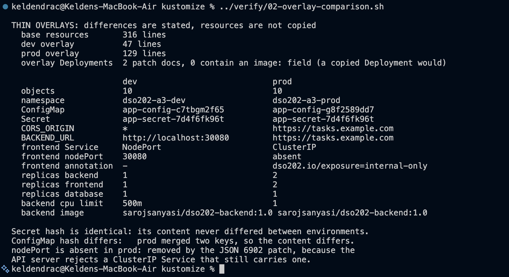
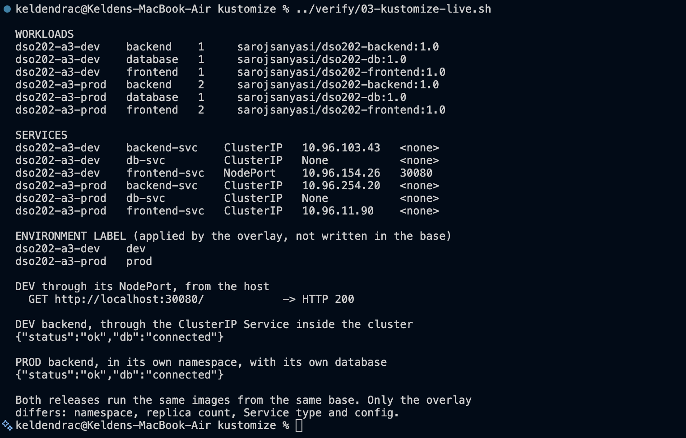
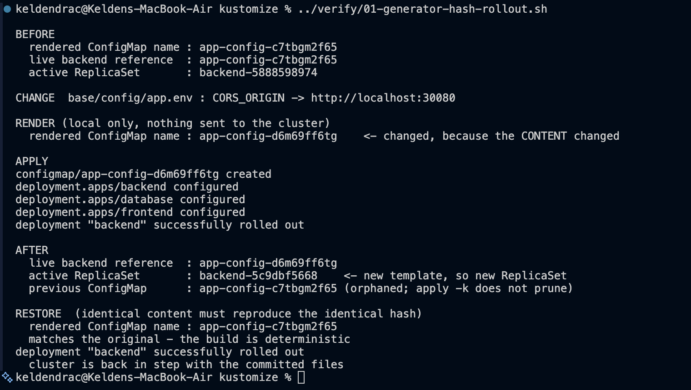
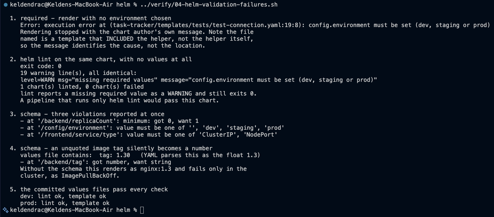
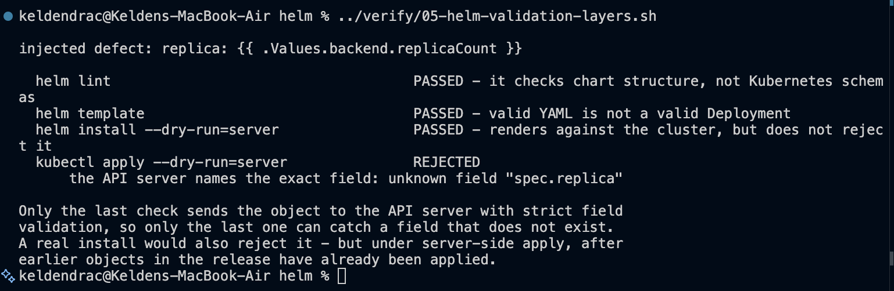
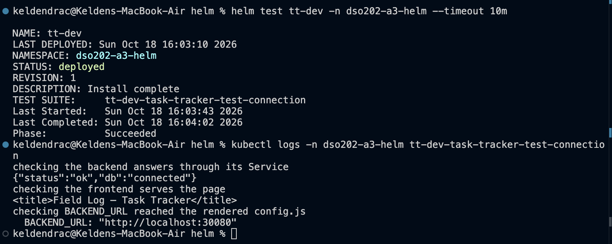
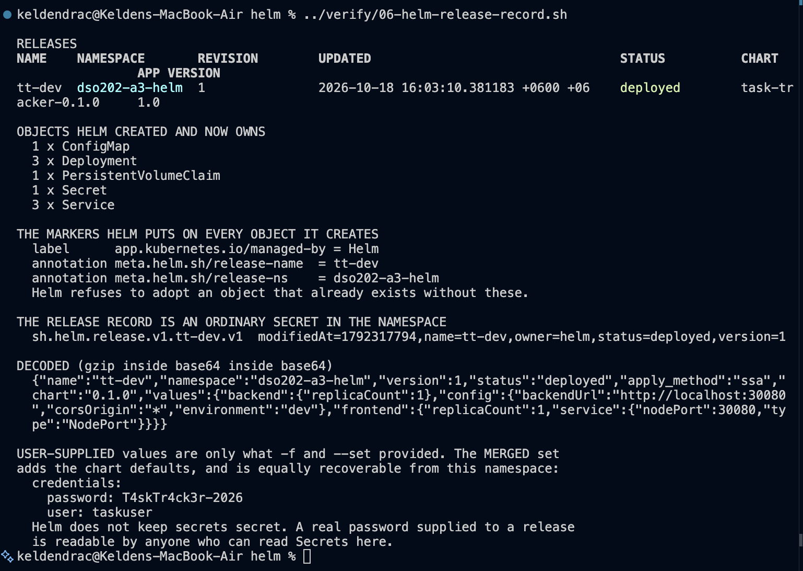
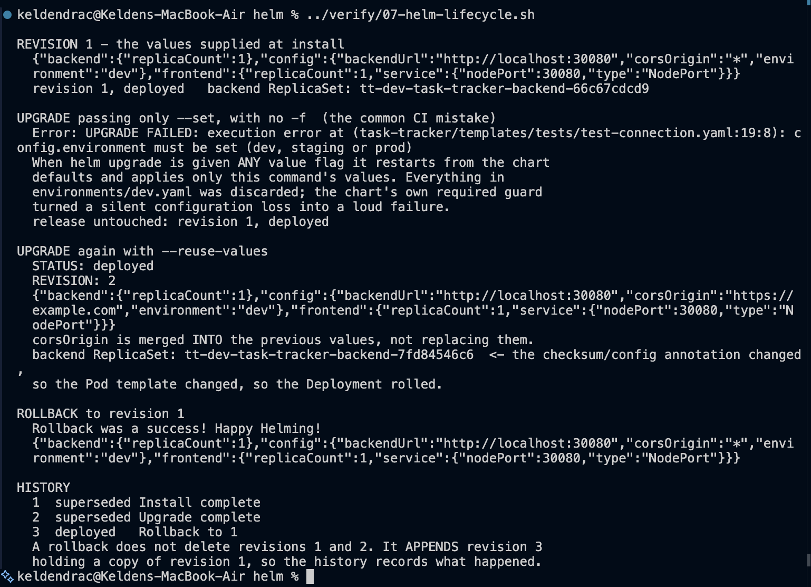
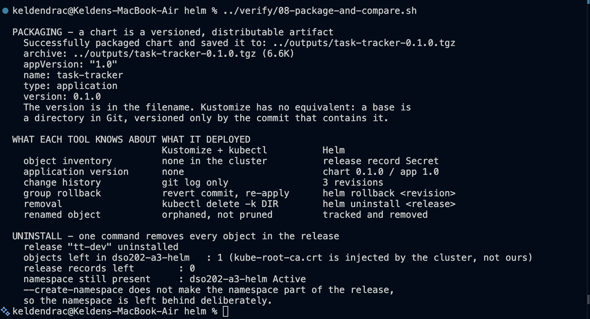

# DSO202 - Assignment 3: Packaging the Task Tracker with Kustomize and Helm

The Assignment 1 three-tier Task Tracker, implemented twice: once as a
Kustomize base with environment overlays, and once as a Helm chart with
environment values files. Same three container images, same application
architecture. Everything that changed is how the configuration is managed.

The point of doing it twice is that the two tools solve overlapping but not
identical problems, and the evidence here shows exactly where they diverge.

| | |
|---|---|
| **Cluster** | kind cluster `dso202` from Practical 1, 1 control-plane + 2 workers, Kubernetes v1.36.1 |
| **Kustomize** | v5.8.1, built into `kubectl` |
| **Helm** | v4.3.0 |
| **Images** | `sarojsanyasi/dso202-{frontend,backend,db}:1.0`, unchanged and pinned |

**Scope note.** The Helm notes end at 3.2.3.2. Sections 3.2.4 to 3.2.8 (lifecycle
hooks beyond `test`, chart dependencies and umbrella charts, CRD handling, and
OCI distribution) are named in the introduction but contain no content, so none
of those features are used here. The one hook that is used, `helm.sh/hook: test`,
appears because the chart would be incomplete without it.

---

## 1. Repository layout

```
assignment-3/
├── cluster/kind-cluster.yaml        the Practical 1 cluster (host port 30080)
├── kustomize/
│   ├── base/                        the common truth, deployable on its own
│   │   ├── kustomization.yaml       compose + transform + generate
│   │   ├── config/app.env           source for the configMapGenerator
│   │   ├── database/                pvc, deployment, headless service
│   │   ├── backend/                 deployment, ClusterIP service
│   │   └── frontend/                deployment, NodePort service
│   └── overlays/
│       ├── dev/                     namespace, labels, replicas
│       └── prod/                    + merged config, 2 strategic patches, 1 JSON 6902
├── helm/
│   ├── task-tracker/                the chart
│   │   ├── Chart.yaml               identity; version vs appVersion
│   │   ├── values.yaml              the configuration interface
│   │   ├── values.schema.json       types and permitted values
│   │   └── templates/               _helpers.tpl, 5 manifests, NOTES.txt, tests/
│   └── environments/                dev.yaml, prod.yaml (deployment, not chart)
├── verify/                          the scripts that produced the evidence
├── outputs/                         rendered YAML and packaged charts (gitignored)
├── evidence/                        screenshots 01-09
└── README.md
```

## 2. Running it

```bash
kind create cluster --config cluster/kind-cluster.yaml
kubectl wait --for=condition=Ready node --all --timeout=600s
```

**Kustomize path**

```bash
cd kustomize
kubectl kustomize overlays/dev          # render first: the rendered YAML is the truth
kubectl diff -k overlays/dev            # ask the API server what would change
kubectl apply -k overlays/dev
kubectl apply -k overlays/prod
kubectl delete -k overlays/dev
```

**Helm path**

```bash
cd helm
helm lint ./task-tracker -f environments/dev.yaml
helm template tt-dev ./task-tracker -f environments/dev.yaml
helm install tt-dev ./task-tracker -f environments/dev.yaml -n dso202-a3-helm --create-namespace --wait --timeout 15m
helm test tt-dev -n dso202-a3-helm
helm uninstall tt-dev -n dso202-a3-helm
```

Both paths use NodePort 30080 for their development environment, so only one of
them can be deployed at a time.

---

## 3. Kustomize

### 3.1 Base and overlay

The base holds every resource and nothing environment-specific. Neither overlay
contains a copied Deployment; both describe only differences.



The size figures are the argument for the design. 316 lines of base resources
are shared by both environments; the dev overlay is 47 lines and the prod
overlay 129. The two Deployment documents that do appear in the overlays are
**patches, not copies** - the script checks that neither contains an `image:`
field, which a copied Deployment necessarily would. A readiness probe added to
the base reaches both environments at once, which is the drift the naive
three-directories approach cannot prevent.

Four kinds of change are visible in the table, and each uses the simplest field
that expresses it:

- **`namespace`** puts every object in the right place, including objects the
  base never named.
- **`labels` with `includeSelectors: false`** adds `app.kubernetes.io/environment`
  for humans and dashboards without touching selectors. That caution is not
  cosmetic: a Deployment's `spec.selector` is immutable after creation and a
  Service's selector decides routing, so a blanket label transformation can
  change an object's identity.
- **`replicas`** is a purpose-built transformer, used instead of a patch file
  containing a single integer.
- **`images`** centralises the three tags in the base, so a release bump touches
  one file rather than three. The rendered output is still fully pinned at
  `:1.0`; `latest` appears nowhere.

### 3.2 Both environments running from one base



Six Deployments across two namespaces, from one base. Dev answers on
`http://localhost:30080` through its NodePort; prod has no NodePort at all and
is reached inside the cluster. Both backends report `{"status":"ok","db":"connected"}`
against their own separate databases.

### 3.3 Generators, and the chain that makes them safe

The ConfigMap is generated from `base/config/app.env` and the Secret from
literals. Neither is a hand-written resource, so the configuration lives in a
file a developer can diff.



This is the most important Kustomize behaviour in the assignment, and the
screenshot walks the whole chain:

1. The rendered ConfigMap is `app-config-c7tbgm2f65`, and the live backend
   references that exact name. The hash is never written by hand.
2. One line of `app.env` changes.
3. Rendering alone - with nothing sent to the cluster - produces
   `app-config-d6m69ff6tg`. **The name changed because the content changed.**
4. `kubectl apply -k` creates the new ConfigMap and reports all three
   Deployments `configured`, because Kustomize rewrote their
   `configMapKeyRef.name` to the new name.
5. That reference lives inside the Pod template, so the template changed, so the
   backend rolled: ReplicaSet `backend-5888598974` became `backend-5c9dbf5668`.

**Content changes, hash changes, reference changes, Pod template changes,
rollout.** Editing a hand-written ConfigMap would have changed nothing about the
running Pods at all.

Two further points the screenshot records:

- **The old ConfigMap is still there.** `kubectl apply -k` does not prune, so
  `app-config-c7tbgm2f65` is now an orphaned object that nothing manages. This
  is the behaviour Helm's release record exists to avoid, and §6 returns to it.
- **The build is deterministic.** Restoring the file reproduces the original
  hash exactly. Two engineers on the same commit get the same manifests.

### 3.4 Patches: two styles, chosen per job

The prod overlay uses both, deliberately:

**Strategic merge** for the resource envelopes
([patch-backend-resources.yaml](kustomize/overlays/prod/patch-backend-resources.yaml)).
The change is naturally a Kubernetes-shaped fragment and targets a named list
item, the `backend` container, so Kustomize matches the object by kind and name
and merges only the fields written. It reads semantically: *for Deployment
backend, make the resources these*.

**JSON 6902** for the Service
([patch-frontend-service.yaml](kustomize/overlays/prod/patch-frontend-service.yaml)).
One of its operations has no clean strategic-merge equivalent:

```yaml
- op: replace
  path: /spec/type
  value: ClusterIP
- op: remove
  path: /spec/ports/0/nodePort
```

The removal is **required, not cosmetic**: the API server rejects a Service of
type ClusterIP that still carries a `nodePort`. Deleting a field nested inside a
list element is exactly what path-level precision is for. The comparison table
confirms it worked - prod renders with `nodePort: absent`.

The patch is given a narrow `target`. `kind: Service` alone would have matched
the backend and database Services too, which may sometimes be the intent but
must always be deliberate.

---

## 4. Two defects found while building this

Both are documented in the manifests themselves, because both were silent.

### 4.1 JSON Pointer escaping applies to the path, not to values

The first version of the Service patch wrote the annotation key inside the
operation's `value`:

```yaml
- op: add
  path: /metadata/annotations
  value:
    dso202.io~1exposure: internal-only        # wrong
```

It rendered successfully and produced an annotation literally named
`dso202.io~1exposure`. The `~1` escape belongs to the **path**, where an
unescaped `/` would be read as a step deeper into the document. The correct form
creates the map first, because `add` cannot create intermediate levels:

```yaml
- op: add
  path: /metadata/annotations
  value: {}
- op: add
  path: /metadata/annotations/dso202.io~1exposure
  value: internal-only
```

The comparison screenshot shows the corrected result:
`dso202.io/exposure=internal-only`.

### 4.2 Name transformation is reference-aware, not value-aware

Both overlays originally carried a `namePrefix` (`dev-`, `prod-`). Kustomize
correctly rewrote every *reference* field - `configMapKeyRef.name`,
`secretKeyRef.name`, `claimName` - and renamed the Service to `dev-db-svc`.

What it did not rewrite was `DB_HOST=db-svc`, because that is an ordinary
**value** inside the ConfigMap's data, not a reference field. The backend then
failed DNS resolution permanently, and because this application has no readiness
probe, **its Pod still reported `1/1 Running` the whole time**. The failure only
surfaced when the API returned nothing.

`namePrefix` was removed rather than worked around. Keeping it would have meant
setting `DB_HOST` per overlay, duplicating knowledge of the prefix in two places
that a reviewer must keep in sync. Two namespaces already isolate the
environments, so the prefix bought nothing and cost a silent outage. The
reasoning is recorded in
[overlays/dev/kustomization.yaml](kustomize/overlays/dev/kustomization.yaml).

This is the practical limit of the "name transformation is reference-aware"
property, and the reason the habit of reading rendered YAML matters more than
reading the overlay.

---

## 5. Helm

### 5.1 The chart

`Chart.yaml` separates the two versions that change for different reasons:
`version: 0.1.0` is the package, `appVersion: "1.0"` is the application inside
it. `appVersion` is quoted so YAML keeps it a string, and the deployment
templates fall back to it when a tier's `tag` is empty, so moving to a new
application image is a one-line change.

`templates/_helpers.tpl` holds the named templates, every one prefixed with the
chart name because named templates are global across a chart and its subcharts.
Two label sets are maintained separately and this is deliberate:
`task-tracker.selectorLabels` is the small, stable set selectors match on, while
`task-tracker.labels` adds `helm.sh/chart` and `app.kubernetes.io/version`,
which change between releases. Putting a changing label into an immutable
selector is how a chart causes its own outage.

Each tier adds `app.kubernetes.io/component` to both its selector and its
template labels, which is what keeps three Deployments in one release from
selecting each other's Pods.

### 5.2 Value validation: two mechanisms, different jobs



**`required` enforces presence.** Rendering with no environment stops with the
chart author's own message. Note that the file named in the error is a template
that *included* the helper, not the helper itself - the message identifies the
cause, the location does not.

**`helm lint` is not sufficient.** On the same chart, with no values at all, it
emits 19 identical warnings and **exits 0**. A pipeline that runs only `helm lint`
would pass a chart that cannot be rendered. The industry practice this implies
is to run `helm lint` *and* `helm template` once per environment values file and
fail on any non-zero exit.

**`values.schema.json` enforces type and permitted values,** and reports every
violation at once rather than the first:

```
- at '/backend/replicaCount': minimum: got 0, want 1
- at '/config/environment': value must be one of '', 'dev', 'staging', 'prod'
- at '/frontend/service/type': value must be one of 'ClusterIP', 'NodePort'
```

Case 4 is the one worth dwelling on. A values file containing `tag: 1.30` is
parsed by YAML as the float `1.3`. Without a schema the chart renders happily
and produces `...-backend:1.3`, an image that does not exist, and the failure
appears only in the cluster as `ImagePullBackOff`. The schema turns that into
`at '/backend/tag': got number, want string` before anything is sent anywhere.

`replicaCount` carries a maximum of 10. That is an operational decision recorded
in code: anyone who needs more has to change the chart through review.

### 5.3 Validation layers: no single check is enough

A misspelled Kubernetes field - `replica` instead of `replicas` - was injected
into a throwaway copy of the chart, so the committed chart was never broken.



| Check | Result |
|---|---|
| `helm lint` | **passed** - it checks chart structure, not Kubernetes schemas |
| `helm template` | **passed** - valid YAML is not a valid Deployment |
| `helm install --dry-run=server` | **passed** - renders against the cluster but does not reject it |
| `helm template \| kubectl apply --dry-run=server` | **rejected**: `unknown field "spec.replica"` |

Templates produce text. They do not validate Kubernetes field names, which is
why the three checks that never send an object to the API server with strict
field validation all let this through. A real install would also reject it, but
under server-side apply that happens *after* earlier objects in the release have
already been applied - a partially applied release rather than a clean refusal.

### 5.4 Install and test



A release reported as `deployed` means the API server accepted the objects, and
with `--wait` that they reached a ready state. It does not mean the application
works. `helm test` is what checks that, and the test Pod's three assertions
cover the whole chain:

- the backend answers through its Service with `{"status":"ok","db":"connected"}`
- the frontend serves the page
- `BACKEND_URL` reached the rendered `config.js`, proving the value travelled
  from `environments/dev.yaml` through the ConfigMap into the running container

The test Pod carries `helm.sh/hook: test`, which keeps it out of install and
upgrade. Its script is a block scalar because it contains `": "`, which YAML
would otherwise read as a key-value separator - a defect that passes `helm lint`
and is caught only by the API server.

### 5.5 What a release is



This is the capability Kustomize has no equivalent of. Helm owns 9 objects as
one unit, and marks every one with `app.kubernetes.io/managed-by: Helm` plus
`meta.helm.sh/release-name` and `-namespace`. Before creating an object, Helm
checks for those markers and **refuses to adopt** an object that already exists
without them, which protects anything created by another tool or person.

The record itself is an ordinary Secret, `sh.helm.release.v1.tt-dev.v1`, stored
as gzip inside base64 inside base64. Decoded, it carries the release name,
namespace, revision, status, chart version, the user-supplied values, and
`apply_method: "ssa"` - recording that Helm 4 created this release with
server-side apply.

The last block is the security consequence, demonstrated rather than asserted.
The *user-supplied* values contain no password, because `environments/dev.yaml`
never sets one. The *merged* values do, and `helm get values --all` prints
`password: T4skTr4ck3r-2026` straight back. **Helm does not keep secrets secret.**
Anyone who can read Secrets in the namespace can recover every value a release
was installed with, which is why a production release supplies credentials from
an external secret manager at install time rather than from a values file.

### 5.6 The upgrade trap, and what a rollback does



This sequence reproduces the failure the notes call one of the most common
causes of production incidents involving Helm.

**The trap.** `helm upgrade` given *any* value flag restarts from the chart
defaults and applies only that command's values. Everything in
`environments/dev.yaml` was discarded by a single `--set`. Here the chart's own
`required` guard converted that silent loss into a loud failure, and because it
failed during rendering, no revision was created and the release stayed at
revision 1, `deployed`. Without that guard the upgrade would have succeeded and
quietly reverted the configuration.

**The fix.** `--reuse-values` merges the new value into the previous ones:
`corsOrigin` becomes `https://example.com` while `environment`, `backendUrl`,
both replica counts and the Service settings survive. Revision 2 is created, and
the backend ReplicaSet moves from `66c67cdcd9` to `7fd84546c6` - because the
`checksum/config` annotation changed, so the Pod template changed, so the
Deployment rolled. That is the same chain as Kustomize's generated-name hash,
reached by a different mechanism.

**The rollback.** `helm rollback tt-dev 1` restores revision 1's values, and the
history shows why that is not a return to the past:

```
1  superseded  Install complete
2  superseded  Upgrade complete
3  deployed    Rollback to 1
```

A rollback **appends** revision 3 holding a copy of revision 1. Revisions are
never renumbered or reused, so the history always records what happened, in
order.

The practice that avoids the trap entirely is to keep every value in a
version-controlled values file and pass all of them with `-f` on every upgrade,
which is why `environments/` exists outside the chart directory.

---

## 6. The two tools compared



`helm package` produced `task-tracker-0.1.0.tgz`, 6.6 KB, with the version in
the filename. Kustomize has no equivalent: a base is a directory in Git,
versioned only by the commit that contains it.

| | Kustomize + kubectl | Helm |
|---|---|---|
| Method | patches plain YAML: base plus overlays | renders templates with values |
| Input files | valid Kubernetes YAML only | templates, not valid YAML until rendered |
| Built into kubectl | yes, `kubectl apply -k` | no, a separate binary |
| Object inventory in the cluster | none | release record Secret |
| Application version | none | chart 0.1.0 / app 1.0 |
| Change history | `git log` only | `helm history`, 3 revisions |
| Group rollback | revert the commit and re-apply | `helm rollback <revision>` |
| Removal | `kubectl delete -k DIR` | `helm uninstall <release>` |
| Renamed object | orphaned, not pruned | tracked and removed |
| Distribution | a Git directory | a versioned `.tgz` in a repository or registry |

The orphan row is the one this assignment demonstrated directly rather than
quoting. In §3.3 the regenerated ConfigMap left `app-config-c7tbgm2f65` behind,
unmanaged, because `kubectl apply -k` has no record of what it previously
created. `helm uninstall` removed every object in the release in one command and
took its records with it.

> **Reading note on the final screenshot.** `objects left` shows `1`, not `0`.
> The count was sampled immediately after `helm uninstall` returned, while one
> object was still terminating; `release records left: 0` is the authoritative
> signal, and a repeat check a few seconds later returns `0`. The script has
> since been given an explicit `kubectl wait --for=delete` before counting.

The namespace survives the uninstall, because `--create-namespace` does not make
the namespace part of the release. That is deliberate, not a leak.

**The two tools are not alternatives.** Kustomize is the better fit for
environment variants of manifests a team writes itself, where plain YAML and a
`git diff` are the review surface. Helm is the better fit for packaging software
for others and for installing third-party software, where a version, a release
record and a group rollback are what the job needs. It is common to install a
third-party chart with Helm and apply organisation-specific patches with
Kustomize.

---

## 7. Notes and deliberate choices

- **`namePrefix` is not used.** See §4.2. It silently desynchronised a ConfigMap
  value from the Service it named.
- **The Secret is generated from literals in `kustomization.yaml`, and the
  Helm chart carries a default password in `values.yaml`.** Both are dummy
  credentials for a disposable local cluster. A Secret is not safe merely
  because its kind is Secret: the data is base64-encoded, which is an encoding,
  not encryption. Committing real credentials because a generator makes it
  convenient is the specific mistake both sets of notes warn about.
- **A single shared `app-config` has a blast radius.** All three tiers reference
  it, so any change rolls all three - visible in §3.3, where one `CORS_ORIGIN`
  edit reported `backend`, `database` and `frontend` as `configured`. Splitting
  it per tier would narrow that, at the cost of duplicating the `DB_NAME` /
  `POSTGRES_DB` pairing across two objects. The shared object was kept because
  that pairing drifting apart is the worse failure.
- **Prod's `BACKEND_URL` is `https://tasks.example.com`,** a stand-in for the
  address a real production deployment would be published at. It does not
  resolve from this laptop, so the prod environment is verified in-cluster
  rather than through a browser.
- **`outputs/` is gitignored.** Rendered YAML and packaged charts are build
  artifacts, regenerable from the committed sources.
- **No chart dependencies, no umbrella chart, no OCI push, no hooks beyond
  `test`.** Those sections of the notes have no content; see the scope note at
  the top.
